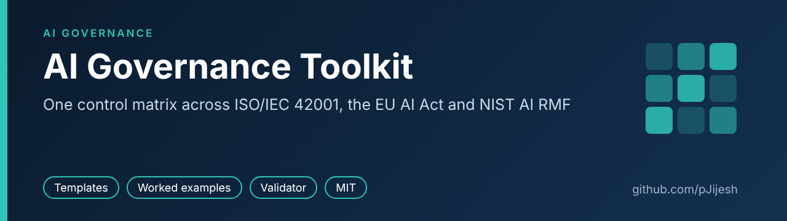
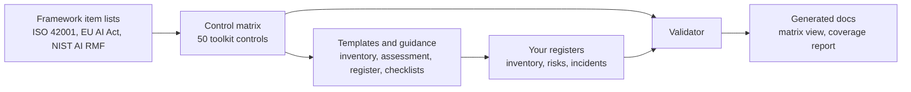

# AI Governance Toolkit



[](https://github.com/pJijesh/ai-governance-toolkit/actions/workflows/ci.yml) [](LICENSE)  

**Problem:** organisations are adopting AI faster than they can show what they use, what could go wrong and who is accountable, and three overlapping frameworks make the first practical steps hard to see.

**For:** IT, risk and compliance managers in mid-size organisations who need a working starting point for AI governance, and reviewers who want to see how the frameworks connect.

**Demonstrates:** a traceable control matrix across ISO/IEC 42001, the EU AI Act and the NIST AI RMF 1.0, practical templates with worked examples, and a small tested tool that keeps the data consistent.



> **Disclaimer.** This toolkit is general information and a set of starting templates. It is not legal advice, it does not guarantee compliance with any law or standard, and it does not lead to certification by itself. Framework identifiers were checked against secondary sources only (see [sources and verification](docs/sources-and-verification.md)). Dates for the EU AI Act have moved before and may move again. Check primary sources and take professional advice before relying on anything here. All example organisations, systems, incidents and people are fictional.

## Contents

| What | Where | Notes |
|---|---|---|
| Control matrix (source of truth) | [`data/control_matrix.csv`](data/control_matrix.csv) | 50 toolkit controls mapped to framework items |
| Control matrix (readable view) | [`docs/control-matrix.md`](docs/control-matrix.md) | Generated. Control view plus a reverse view per framework |
| Framework item lists | [`data/frameworks/`](data/frameworks/) | ISO/IEC 42001 clauses 4 to 10 and Annex A, selected EU AI Act articles, all 72 NIST AI RMF subcategories |
| Coverage report (sample output) | [`docs/coverage-report.md`](docs/coverage-report.md) | Generated. Shows framework items with no mapped control |
| AI system inventory | [`templates/ai-system-inventory.md`](templates/ai-system-inventory.md), [`.csv`](templates/ai-system-inventory.csv) | Guidance, blank header and classification notes |
| AI impact assessment | [`templates/ai-impact-assessment.md`](templates/ai-impact-assessment.md) | Form plus a filled example |
| AI risk register | [`templates/ai-risk-register.md`](templates/ai-risk-register.md), [`.csv`](templates/ai-risk-register.csv) | 5 by 5 scoring method and treatment choices |
| Acceptable use policy starter | [`templates/ai-acceptable-use-policy.md`](templates/ai-acceptable-use-policy.md) | Policy text, decisions to make and an approved tools register example |
| Vendor and supplier review | [`templates/ai-vendor-review-checklist.md`](templates/ai-vendor-review-checklist.md) | Questionnaire with evidence column and a filled example |
| Human oversight checklist | [`templates/human-oversight-checklist.md`](templates/human-oversight-checklist.md) | Tests whether oversight works in practice |
| System documentation card | [`templates/ai-system-card.md`](templates/ai-system-card.md) | A practical minimum record per system |
| AI incident log | [`templates/ai-incident-log.md`](templates/ai-incident-log.md), [`.csv`](templates/ai-incident-log.csv) | Handling steps and external reporting points |
| Worked examples (fictional) | [`examples/fernhill/`](examples/fernhill/) | Inventory, risk register and incident log for a made-up company |
| EU AI Act timeline note | [`docs/eu-ai-act-timeline.md`](docs/eu-ai-act-timeline.md) | Dates as at 4 November 2026, with verification status |
| 90-day adoption plan | [`docs/how-to-adopt.md`](docs/how-to-adopt.md) | Roles, RACI and weekly steps for a non-specialist |
| Sources and verification | [`docs/sources-and-verification.md`](docs/sources-and-verification.md) | What was checked, against what, and what was not |
| Validator and report generator | [`tools/validate_and_report.py`](tools/validate_and_report.py) | Python standard library only |
| Register health report | [`tools/register_health.py`](tools/register_health.py), [example output](docs/register-health-example.md) | Dates the registers against today: overdue reviews, late risk actions, stuck incidents |
| Tests | [`tests/`](tests/) | `unittest`, also runs under `pytest` |
| Continuous integration | [`.github/workflows/ci.yml`](.github/workflows/ci.yml) | Runs the validator and tests on push |
| Contributing | [`CONTRIBUTING.md`](CONTRIBUTING.md) | Ground rules and workflow |

## Quick start

You need Python 3.9 or later and nothing else.

```
git clone https://github.com/pJijesh/ai-governance-toolkit.git
cd ai-governance-toolkit
python tools/validate_and_report.py          # validate the data and regenerate the docs
python -m unittest discover -s tests -v      # run the tests
```

Then:

1. Read the [90-day plan](docs/how-to-adopt.md) to see the order of work.
2. Copy [`templates/ai-system-inventory.csv`](templates/ai-system-inventory.csv) and list the AI systems you use. The [guidance](templates/ai-system-inventory.md) explains each column.
3. Open [`docs/control-matrix.md`](docs/control-matrix.md) to see which controls relate to which clauses, articles and subcategories.
4. If you change a CSV in `data/`, run the tool again. In CI the same command runs with `--check` and fails if the generated documents are out of date.
5. Once you keep registers, run `python tools/register_health.py --registers path/to/your/registers` each month to see what needs action. See [the example report](docs/register-health-example.md).

## How the pieces fit together

The diagram at the top of this page shows the flow.

- The **framework item lists** are plain CSV files with identifiers and short paraphrased titles. They are the reference the tool checks mappings against.
- The **control matrix** turns three frameworks into one working list of controls. Each control names an owner, the evidence you would expect to see, and the template that supports it.
- The **templates** are where a control becomes something a person does. Each one lists the controls it supports and contains a filled example.
- The **registers** (inventory, risk register, incident log) are CSV files so they can be checked. The validator confirms that a risk points at a real system, that a control reference exists and that scores add up.
- The **generated documents** make gaps visible. A framework item with no mapped control shows up in the coverage report.

## What the validator checks

- Required columns, unique IDs and ID formats in every CSV.
- No orphan mappings: every ISO, EU and NIST reference in the control matrix must exist in the framework lists.
- Template files named in the matrix exist.
- In the registers: valid enumerated values, ISO dates, risk scores that equal likelihood times impact, rating bands, and references to real systems and controls.
- Relative links in markdown files resolve.
- Generated documents match the data (with `--check`).

The checks test structure and consistency. They cannot tell you whether a risk is well judged or a control works.

## What the register health report checks

The validator asks whether the registers are well formed. `tools/register_health.py` asks which entries need someone to act on a given date. It reads the same three CSV files and reports:

| Rule | Finding |
|---|---|
| RH01 | A system review date has passed (raised for high-risk tiers) |
| RH02 | A live or pilot system has no open risk recorded |
| RH03 | A risk is past its target date and still open or mitigating |
| RH04 | An open risk has not been reviewed within the window (default 90 days) |
| RH05 | A high or critical residual risk is not closed |
| RH06 | An accepted risk has not been re-confirmed within the window (default 180 days) |
| RH07 | An incident is still open after the window (default 30 days) |
| RH08 | A decision on external reporting is still under assessment after the window (default 14 days) |
| RH09 | An incident has no risk of a matching category on the same system, so it has not fed the risk register |

```
python tools/register_health.py --registers my-registers --as-of 2027-01-31
python tools/register_health.py --registers my-registers --fail-on high   # exit 1 for use in a scheduled job
```

The windows are working defaults and can be changed with `--review-days`, `--accepted-days`, `--incident-days` and `--report-days`. They are not legal limits, and the report cannot tell you whether a reporting duty applies. The [example report](docs/register-health-example.md) is generated from the fictional Fernhill registers at a fixed date and is checked in CI.

## Limitations

Please read these before you use or cite the toolkit.

- **Not legal advice and not certification.** Using the toolkit does not make an organisation compliant or certified. ISO/IEC 42001 certification involves an accredited audit.
- **Identifiers verified from secondary sources only.** The paid ISO standard has not been read directly, and the EUR-Lex text has not been checked article by article. See [sources and verification](docs/sources-and-verification.md). Every item carries a `verification` flag.
- **Mappings are judgement.** They show relatedness and are not an official crosswalk. Full "coverage" in a report means a control relates to an item, not that the item is met.
- **Known unmapped items.** The coverage report lists NIST subcategories with no mapped control. These are left visible on purpose.
- **EU dates may change.** The timeline reflects the Digital Omnibus as reported by law firms. Wording of Art 4 and Art 5 changed under it, so re-check those articles.
- **Thin on provider duties.** The toolkit leans towards organisations that buy and use AI (deployers). Duties of providers of high-risk systems and general-purpose AI model providers are covered by two conformity controls and by supplier due diligence only.
- **Scope.** ISO/IEC 42001 Annex B guidance, other AI standards, UK sector rules and non-EU laws are not mapped. UK data protection law is referred to but not mapped.
- **Templates are starters.** They have not been audited or tested in a live organisation. All worked examples are fictional.
- **CI untested on GitHub.** The workflow file is written and the same commands were run locally, but the workflow itself has not yet run on GitHub.

## Roadmap

Planned, not promised. Order and timing change with other work.

- **Next:** Add AI use-case scoring sheet (return, risk, data readiness); Refresh EU AI Act timeline and mappings
- **Then:** Add ISO/IEC 42001 evidence checklist; Add a second worked example (customer service assistant)
- **Later:** Refresh NIST AI RMF crosswalk; Release v1.1

## Related work

- [ai-use-register-skill](https://github.com/pJijesh/ai-use-register-skill): an agent skill that finds AI use in code and builds an inventory that cites its evidence. Its output can feed the inventory in this toolkit.
- [eu-ai-act-tracker](https://github.com/pJijesh/eu-ai-act-tracker): the EU AI Act milestones as sourced data, for keeping the timeline note current.
- [eu-ai-act-risk-classifier](https://github.com/pJijesh/eu-ai-act-risk-classifier): a short questionnaire that suggests a risk tier, to help fill the `eu_risk_tier` column.
- [awesome-ai-governance](https://github.com/pJijesh/awesome-ai-governance): a curated list of regulation, standards, guidance and tools with a link checker.

## Licence

Released under the [MIT Licence](LICENSE). Copyright (c) 2026 Puliyappottammal Jijesh. ISO/IEC 42001 is a copyrighted standard and no part of its text is reproduced here. Framework names are used to identify the documents they refer to.

## Author

**Puliyappottammal Jijesh**, IT Manager, Greater London. Interested in practical AI governance for mid-size organisations. Has ISO/IEC 42001 training and working knowledge of the EU AI Act and the NIST AI RMF.

- GitHub: [pJijesh](https://github.com/pJijesh)
- LinkedIn: [linkedin.com/in/pjijesh](https://www.linkedin.com/in/pjijesh)

This is a personal project. It is not affiliated with, and does not represent, any employer or client. Corrections and suggestions are welcome (see [CONTRIBUTING](CONTRIBUTING.md)).
